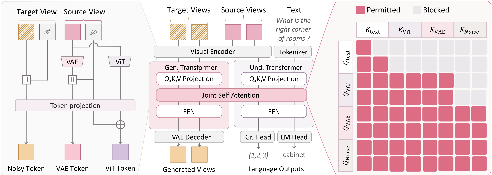

<div align="center">
  <h1>Can Learning to Answer Spatial Questions Improve Novel-View Generation?</h1>
</div>

<div align="center">
  <a href="https://jahyeok-koo.github.io/">Jahyeok Koo</a><sup>1</sup>,
  <a href="https://hdeori.github.io/">Hyeonseo Yu</a><sup>1</sup>,
  <a href="https://hugeson0235.github.io/">Seungho Jang</a><sup>1</sup>,
  <a href="https://crepejung00.github.io/">Jaewoo Jung</a><sup>1</sup>,
  <a href="https://loggerjk.github.io/">Jiwon Kang</a><sup>1</sup>,
  <a href="https://seokju-cho.github.io/">Seokju Cho</a><sup>1</sup>,
  <a href="https://cvlab.kaist.ac.kr/members/faculty">Seungryong Kim</a><sup>1,†</sup><br><br>
  <sup>1</sup>KAIST AI · <sup>†</sup>Corresponding author
</div>

<br>
<br>

<p align="center">
  <a href="https://cvlab-kaist.github.io/Ask4NV/" target="_blank" rel="noopener noreferrer" style="display: inline-block;"></a>&nbsp;
  <a href="https://arxiv.org/abs/xxxx.xxxxx" target="_blank" rel="noopener noreferrer" style="display: inline-block;"></a>&nbsp;
  <!-- <a href="https://huggingface.co/xxx" target="_blank" rel="noopener noreferrer" style="display: inline-block;"></a>&nbsp; -->
</p>

<br>

## Abstract

Generating novel views from limited observations requires preserving both the appearance and spatial structure of a scene. Although recent approaches exploit fine-grained geometric cues, they do not explicitly model high-level semantic and spatial properties such as object identity, attributes, and inter-object relationships. In this work, we investigate whether **3D language understanding can provide complementary supervision for novel-view generation**. We introduce **Ask4NV**, built on a pretrained unified multimodal model with a Mixture-of-Transformers (MoT) architecture. Our model incorporates camera geometry into both VAE and ViT representations and leverages understanding features during generation through joint self-attention with a modality-aware attention masking strategy. Experiments demonstrate strong image quality and geometric consistency in novel-view generation, alongside competitive 3D language understanding. Further analysis shows that joint training improves cross-view correspondence in VAE representations and similarity in a 3D-aware feature space.

<div align="center">
  
</div>

## What to expect

- [ ] 🛠️ Training code and configs (joint novel-view generation + 3D question answering / grounding)
- [ ] 📊 Evaluation scripts: novel-view generation (DL3DV, ScanNet, RealEstate10K, ScanNet++) and 3D language understanding (SQA3D, ScanQA, ScanRefer, Multi3DRefer)
- [ ] 🔍 Analysis tools: layer-wise cross-view correspondence and 3D-aware feature similarity
- [ ] 🧠 Pretrained checkpoints

## Citation

```bibtex
TBD
```
